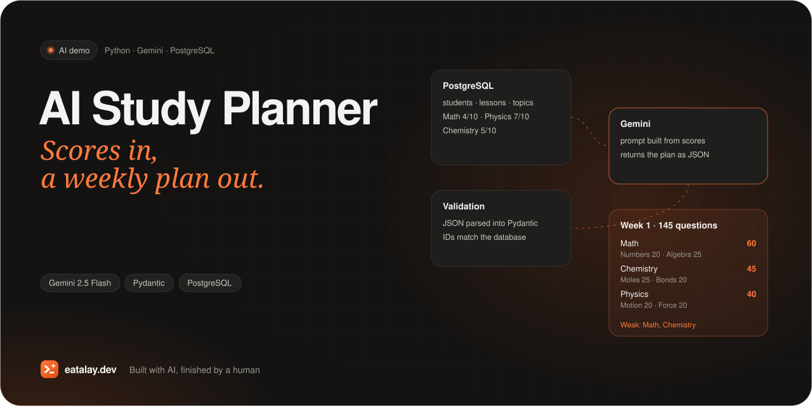

**Turn exam scores into a weekly study plan.** The app reads subjects, topics and a student's scores (out of 10) from PostgreSQL, sends them to Gemini, and gets back a plan that says how many questions to solve per topic this week, which subjects are weak and what to focus on. The plan comes back as JSON, is validated with Pydantic and refers to the same subject and topic IDs as the database, so it can be stored or shown in any app.

> A small, complete example of the kind of AI automation I build for clients: real data in, an LLM in the middle, structured and checked output out.

## How it works

1. **Read** subjects, topics and the student's latest reports from PostgreSQL.
2. **Prompt** Gemini 2.5 Flash with that data as JSON and clear rules: plan in question counts, use the given IDs.
3. **Validate** the reply: extract the JSON, parse it into Pydantic models and reject anything that doesn't fit.
4. **Show** the plan in a colourful console UI, ready to be saved or sent on.

**Example output**

```json
{
  "week_number": 1,
  "total_questions": 180,
  "subject_plans": [
    {
      "subject_id": "11111111-1111-1111-1111-111111111111",
      "subject_name": "Math",
      "total_questions": 60,
      "topics": [
        { "topic_id": "a1111111-1111-1111-1111-111111111111", "topic_name": "Numbers", "question_count": 20 },
        { "topic_id": "a2222222-2222-2222-2222-222222222222", "topic_name": "Algebra", "question_count": 25 }
      ]
    }
  ],
  "weak_subjects": ["Math", "Physics"],
  "recommendations": ["Solve at least 20 questions a day on weak topics", "Redo the questions you got wrong"]
}
```

## Architecture

| Layer | File | Role |
| --- | --- | --- |
| Models | `models.py` | Pydantic models for subjects, topics, reports and the plan |
| Interfaces | `interfaces.py` | Contracts, so the AI provider or database can be swapped |
| Services | `gemini_service.py`, `study_plan_service.py` | Prompting, parsing and the planning flow |
| Data | `database_repository.py` | PostgreSQL access with SQLAlchemy |
| UI | `console_ui.py` | Menu and coloured output |
| Config | `config.py` | Environment variables and model choice |

Repository pattern for data access, a service layer for the logic and constructor injection between them. Replacing Gemini with another model means one new class behind the same interface.

## Run it

Python 3.12+, a PostgreSQL database and a Gemini API key.

```bash
pip install -r requirements.txt
cp .env.example .env   # set GEMINI_API_KEY and DATABASE_URL
python main.py
```

<details>
<summary>Database tables</summary>

```sql
CREATE TABLE public."Subjects" (
    "Id" UUID PRIMARY KEY DEFAULT gen_random_uuid(),
    "Name" VARCHAR(100) NOT NULL
);

CREATE TABLE public."Topics" (
    "Id" UUID PRIMARY KEY DEFAULT gen_random_uuid(),
    "Name" VARCHAR(100) NOT NULL,
    "SubjectId" UUID REFERENCES public."Subjects"("Id")
);

CREATE TABLE public."Students" (
    "Id" UUID PRIMARY KEY DEFAULT gen_random_uuid(),
    "Name" VARCHAR(100) NOT NULL,
    "CreatedAt" TIMESTAMP DEFAULT CURRENT_TIMESTAMP
);

CREATE TABLE public."StudentReports" (
    "Id" UUID PRIMARY KEY DEFAULT gen_random_uuid(),
    "StudentId" UUID REFERENCES public."Students"("Id"),
    "Subject" VARCHAR(100) NOT NULL,
    "Topics" TEXT NOT NULL,
    "Score" INTEGER CHECK ("Score" >= 0 AND "Score" <= 10),
    "CreatedAt" TIMESTAMP DEFAULT CURRENT_TIMESTAMP
);
```

</details>

The console UI and the data it ships with are in Turkish.

---

<sub>Made by **Emrah Atalay** at <a href="https://eatalay.dev/en">eatalay.dev</a>: mobile apps, games and automation, built with AI and finished by a human. Want to automate a workflow with AI? <a href="mailto:info@eatalay.dev">info@eatalay.dev</a></sub>
